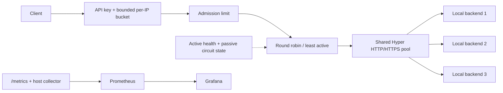
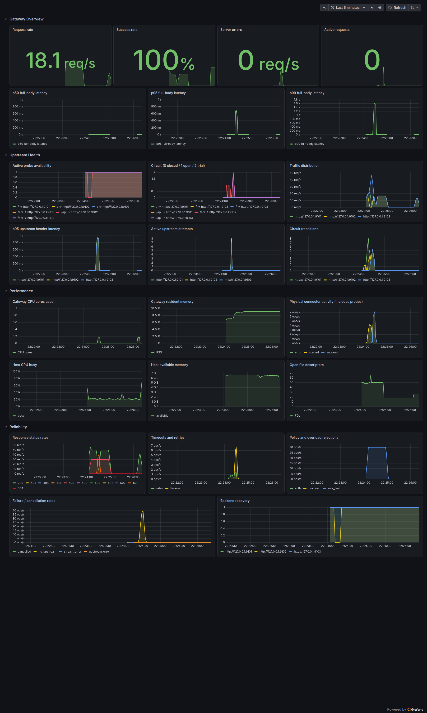

# Aether Gateway

A locally runnable Rust API gateway for studying asynchronous networking,
connection reuse, traffic management, and observable failure recovery. Aether
uses **Tokio, Axum, Hyper, and Rustls**, streams HTTP bodies, and exposes
Prometheus metrics with a provisioned Grafana dashboard.

This is an engineering prototype with measured boundaries. It has no cloud,
CI/CD, container deployment, or Kubernetes requirement.



## Run locally

Prerequisites: Rust 1.93+, Node.js, Python 3.11+, curl, and Linux for the recorded
resource measurements. Building the optional native NGINX tool also needs a C
compiler and make. No Node/Python packages are required. Native oha and
NGINX are needed only for benchmarks; Prometheus, Grafana, and node_exporter are
optional for the visual demonstration.

```bash
cargo build --release --locked
./scripts/demo.sh start
curl http://127.0.0.1:3000/health
curl http://127.0.0.1:3000/ready
curl -H 'x-api-key: local-demo-key' http://127.0.0.1:3000/api/echo
curl http://127.0.0.1:3000/metrics
```

The default configuration binds only loopback and starts three fixture backends
on ports 9101–9103. `/api/` strips its prefix and uses least-active selection;
`/` uses round robin. Routes are first-match segment prefixes. The demonstration
key is a local example, not a secret-management mechanism.

```bash
# Optional native tools: pinned versions, SHA-256 checked, no sudo.
# Full download includes ~600 MiB of observability archives; extracted Grafana
# is roughly 1.5 GiB. Add --bench-only to fetch just oha + NGINX.
python3 scripts/fetch-tools.py
export PATH="$PWD/.local/tools:$PATH"
./scripts/observability.sh start
./scripts/demo.sh traffic
```

Open [Grafana](http://127.0.0.1:3005/d/aether-systems) and
[Prometheus](http://127.0.0.1:9090). Grafana has anonymous **local viewer** access.
The repository contains native provisioning and an importable dashboard JSON
at [observability/grafana/dashboards/aether.json](observability/grafana/dashboards/aether.json).
The scripts write logs and PID files under ignored `.local/`.



## Features and important behavior

- Shared connection pool with keep-alive expiry/capacity; TCP_NODELAY on accepted
  and upstream sockets; verified HTTPS upstreams and HTTP/2 where supported.
- Request and response streaming; method, encoded path/query, end-to-end header,
  and status forwarding; all repeated Connection-nominated headers removed.
- Multiple origins per route; round robin or least-active requests, rotating
  ties; active HEAD probes exclude and reintegrate peers.
- Connect, response-header, and total body deadlines; consecutive-failure
  circuits with one half-open trial and protection from stale completions.
- At most three attempts; only bodyless GET/HEAD/OPTIONS can retry; bounded
  exponential backoff within a shared deadline. POST is never replayed.
- Global fail-fast admission; known-body size checks and streaming upload cap;
  bounded per-IP token buckets with expiry; API-key authentication.
- Structured JSON tracing (`RUST_LOG=aether_gateway=debug` for completion logs),
  Linux process metrics, host metrics, and a 24-panel Grafana dashboard.
- Graceful SIGINT/SIGTERM drain with a configurable final shutdown deadline.

`/health`, `/ready`, and `/metrics` bypass gateway policy and are excluded from
application request metrics. `/ready` requires one eligible peer for every
route; startup is fail-closed until probes succeed. Overload/no eligible peer
returns 503; rate limiting returns 429; both include `Retry-After: 1`.
Transport errors generally return 502 and deadlines return 504. A failure after
headers truncates the stream and records an event; it cannot replace the status
already sent.

## Exercise failures and verify behavior

```bash
./scripts/demo.sh kill-upstream 9102
./scripts/demo.sh recover-upstream 9102
./scripts/demo.sh slow 9102
./scripts/demo.sh reset
python3 scripts/verify.py
python3 scripts/protocol-check.py  # public HTTPS trace endpoint; requires oha
cargo fmt --check
cargo clippy --all-targets -- -D warnings
```

The default bucket allows a burst of 100 and 50 requests/s sustained, so an
unrestricted traffic run intentionally generates 429s. `scripts/verify.py` is a
targeted local demonstration utility, not a test framework. It creates isolated
processes, reports observed results, and tears them down. Recorded functional
checks are in [docs/evidence/functional/results.json](docs/evidence/functional/results.json).

Stop the local processes with:

```bash
./scripts/demo.sh stop
./scripts/observability.sh stop
```

## Performance evidence

On this shared i5-10300H workstation, the enhanced gateway measured **23,666
successful requests/s** at 32 concurrent connections, versus **25,892** for
native NGINX. These are medians of three 5-second runs after 2-second warm-ups,
with a 256-byte HTTP/1.1 response and authentication/rate limiting disabled.
All successful-proxy samples returned 200 without transport errors. The single
Node backend was near one full CPU; this does not establish the gateway's ceiling.

See [BENCHMARKS.md](BENCHMARKS.md) for the native comparison, all raw output,
CPU/RSS measurements, socket reuse, and experimental limitations. Reproduce it
with:

```bash
DURATION=5s WARMUP=2s RUNS=3 CONCURRENCIES=1,32,128 ./bench/run.sh
```

The harness compares direct access, the original Git commit, an explicitly
labeled original variant with its hardcoded limiter relaxed, the staged pooled
baseline, the enhanced gateway, and native multi-worker NGINX. Successful 2xx
RPS is reported separately from all-response RPS. Targets alternate order
across repeats, use a shared 256-byte fixture response and persistent HTTP/1.1,
and record gateway/upstream/load-generator CPU plus gateway peak sampled RSS.
The benchmark disables authentication and rate limiting for comparable proxy
work; observability and resilience remain enabled in the enhanced gateway.

Historical 15.8× and “within 2.7% of NGINX” claims match earlier saved JSON
arithmetic, but describe earlier builds and conditions. They are not promises
about this revision. Do not compare rejected-request throughput against
successful proxy throughput.

## Boundaries and further reading

This prototype lacks frontend TLS termination, WebSocket/CONNECT support,
distributed policy state, dynamic discovery, reload, a global retry budget,
probe hysteresis, and strict slow-client connection limits. The admitted-work
semaphore does not cap idle downstream sockets. Body deadlines apply when
polled and cannot guarantee a wall-clock socket bound if a downstream stops
reading. Hyper does not publicly expose pool hits/occupancy; connector metrics
and backend accepts demonstrate reuse without inventing those measurements.

- [Architecture and request lifetime](docs/ARCHITECTURE.md)
- [Engineering decisions and trade-offs](docs/DESIGN_DECISIONS.md)
- [Failure behavior and evidence](docs/FAILURE_ANALYSIS.md)
- [Interview deep dive](docs/INTERVIEW_DEEP_DIVE.md)
- [Benchmark methodology and results](BENCHMARKS.md)
- [Evidence-backed resume bullets](docs/RESUME_BULLETS.md)
