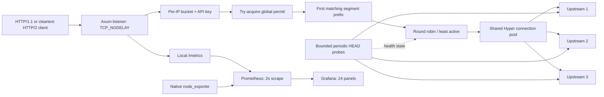

# Architecture and request lifecycle

Aether is a local asynchronous HTTP reverse proxy. It accepts HTTP requests,
chooses a configured backend, and streams the backend's response to the caller.
It concentrates authentication, resource admission, failure handling, and
measurement at one boundary. It does not implement a service control plane.

## Ownership and concurrency

One `Arc<ProxyState>` owns immutable validated configuration, the pooled Hyper
client, routes, metric handles, a semaphore, and the bounded rate-limit map.
`client.rs` wraps the native HTTP/TLS connector to count actual connection
attempts. Hyper owns protocol tasks and pooled sockets; there is no socket
creation in the request handler. An idle-pool timer is explicitly configured,
not merely an idle duration. HTTPS uses Rustls, public WebPKI roots, hostname
verification, and ALPN for HTTP/2. Plain HTTP origins use HTTP/1.1; incoming
cleartext HTTP/2 uses prior knowledge, not an HTTP/1 Upgrade handshake.

Each route has its own cursor and endpoint records. A short standard mutex
covers selection and reservation; each circuit has a separate short mutex.
Atomic active counters include the response-body lifetime, not just header
latency. Locks never cross an asynchronous await. Selection takes the route
lock before a circuit lock; completion takes only a circuit lock, avoiding a
reverse lock order. Routes referencing the same origin have independent health
probes and breakers; they share the client's origin-keyed socket pool.

The per-IP map uses one synchronous mutex, a maximum entry count, and at most
one expiry sweep per second. Disabled limiting avoids the mutex entirely. This
is bounded and simple, but an O(max_clients) expiry scan can delay competing
requests. Multi-IP lock contention was not profiled and sharding is deferred.

## Request lifecycle

1. Resolve the first matching prefix, respecting segment boundaries: `/api`
   matches `/api/users`, not `/apiculture`. A trailing-slash prefix is permitted.
   `/health`, `/ready`, and `/metrics` are reserved local endpoints.
2. Begin active-request and lifetime observation. Apply the real socket peer's
   token bucket, then API-key authentication. Forwarded IP headers are ignored.
3. Try to acquire a global permit; return 503 with `Retry-After: 1` immediately
   if full. This is rejection-based backpressure, with no application queue.
   Reject known oversized bodies with 413 and unsupported tunnels/upgrades with
   501. No complete request or response body is buffered by the gateway.
4. Strip the optional route prefix, retain the encoded path and query, and join
   with a startup-validated HTTP(S) origin. Remove every `Connection`-nominated
   header and standard hop headers. Hyper generates the upstream Host header.
   Normalize the outbound request version so inbound h2 cannot force h2c on an
   HTTP/1 backend. Methods and end-to-end headers are retained.
5. Choose an eligible endpoint. Round robin rotates by attempt. Least-active
   rotates ties and counts selected attempts until EOF/error/drop. Health starts
   false; initial requests receive 503 until a successful HEAD probe.
6. Race the upstream request against the smaller of the attempt response-header
   timeout and the remaining total deadline. The connector separately bounds
   DNS/TCP/TLS establishment. A response-header timeout includes upload time.
7. For bodyless GET/HEAD/OPTIONS only, transport/header failures and 502/503/504
   can trigger another attempt. Prefer a different endpoint. Attempts are capped
   at three by validation; configuration defaults to two. Exponential backoff,
   each attempt, and streamed bodies share a deadline. No retry follows headers
   sent to the downstream client. Unconsumed retry response bodies are dropped,
   which can sacrifice an HTTP/1 keep-alive connection.
8. Return headers and wrap the streaming response body with `DeadlineBody`.
   Its observation owns the semaphore permit and endpoint lease. EOF records a
   result; errors release resources and count a stream failure; dropping it on
   disconnect releases resources and counts cancellation. A status counter
   records the chosen header status; a later broken 200 stream remains a 200
   plus a failure event, rather than being incorrectly relabeled a 504.

## Health and circuits

One non-overlapping probe task per configured route/endpoint sends HEAD to the
configured health path at a fixed interval. A 2xx status is healthy; timeout,
transport failure, and other statuses make it unavailable. Missed ticks skip
rather than queue. These probes bypass proxy policy and are excluded from
upstream application-attempt counters. Physical connector counters include them.

A breaker counts unsuccessful completed attempts (transport failures, header
and body deadline errors, and upstream 5xx). After the configured consecutive
failure threshold, it opens. When its cooldown expires, one eligible request
can reserve a half-open trial. Other traffic is excluded until that trial
finishes. Success closes it; failure or cancellation reopens it. Successful
health probes alone do not reset a broken application endpoint's circuit.
Generation numbers prevent old in-flight completions from closing a newer
circuit. In a closed generation, “consecutive” means completion order.

## Shutdown and boundaries

SIGINT/SIGTERM stops accepting new connections and asks Axum to drain existing
requests. A second timeout bounds that drain; the Tokio runtime then closes
remaining tasks. Probe tasks are aborted after draining. `/ready` requires at
least one currently eligible or cooldown-expired endpoint per route; `/health`
only reports that the process can answer. Neither endpoint authenticates.

The semaphore bounds admitted work, including bodies and backoff. It does not
bound idle downstream TCP connections, parser resources before admission, or
kernel socket buffers. A body deadline is enforced when Hyper polls that body;
a downstream that stops reading can prevent timely polling. This is not a full
slow-client defense or a strict wall-clock socket lifetime limit. See
[FAILURE_ANALYSIS.md](FAILURE_ANALYSIS.md).
